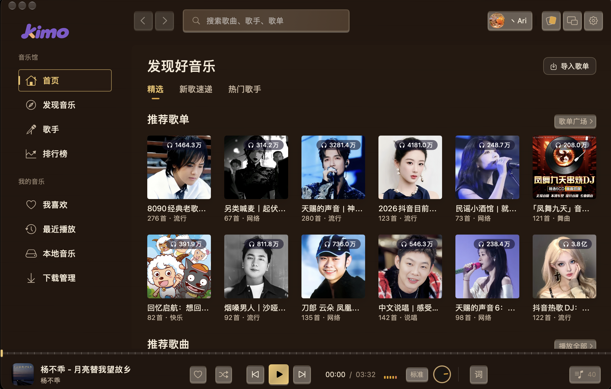
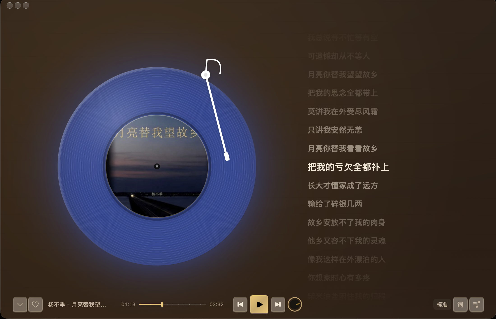
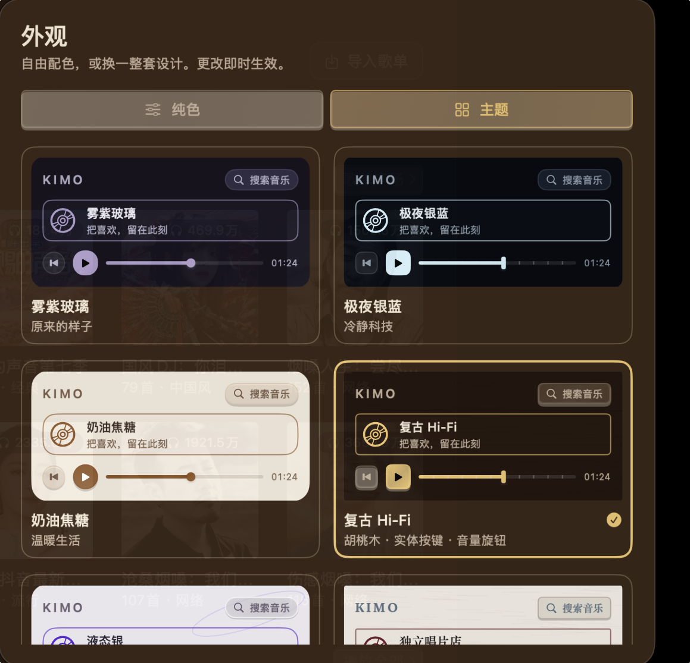
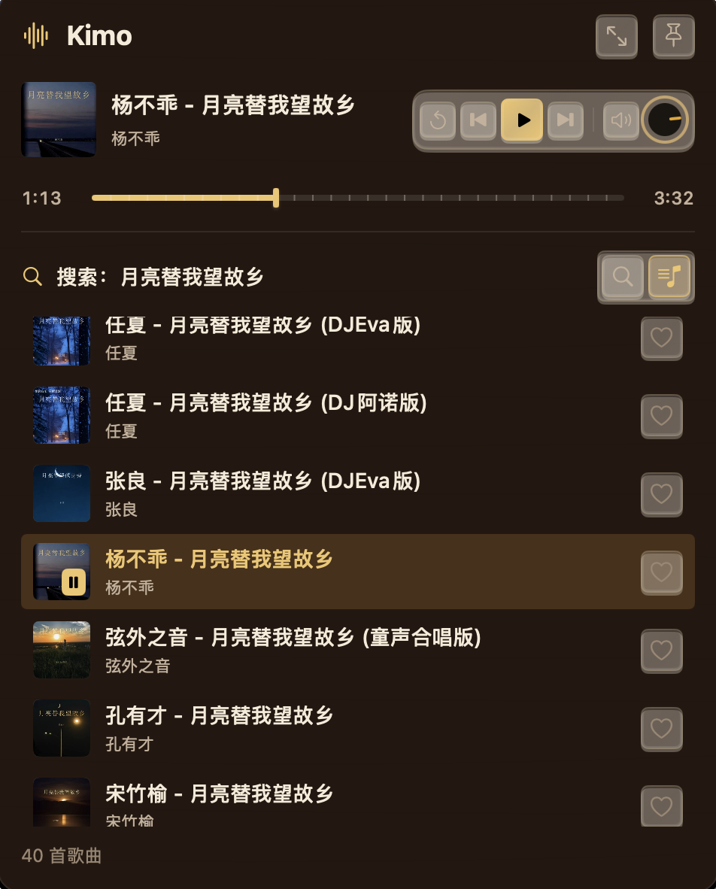

# Kimo

macOS 原生音乐播放器：**核心复用 [MoeKoeMusic](https://github.com/MoeKoeMusic/MoeKoeMusic)**。

- UI：SwiftUI + AppKit 无边框玻璃窗口，逐像素对照 `cocomusic/src/**/*.module.css` 还原
- 核心：MoeKoeMusic 的 `kugoumusicapi`（236 个酷狗接口模块）+ express 路由 + 设备指纹，作为子进程托管
- 播放：AVPlayer 队列播放器

```
┌─────────────────────────────────────────────┐
│ Kimo.app (Swift)                            │
│  ┌───────────────┐   HTTP 127.0.0.1:6520    │
│  │ SwiftUI 界面   │ ───────────────────────┐ │
│  │ AVPlayer       │                        │ │
│  └───────────────┘                        │ │
│                      ┌────────────────────▼─┴──┐
│                      │ CoreRuntime (Node)      │
│                      │  kugoumusicapi + express│
│                      └─────────────────────────┘
└─────────────────────────────────────────────┘
```

## 界面预览

**首页 · 复古 Hi-Fi 主题**



**播放页 · 唱片与同步歌词**



<table>
  <tr>
    <th>主题外观</th>
    <th>迷你播放器</th>
  </tr>
  <tr>
    <td></td>
    <td></td>
  </tr>
</table>

截图展示 macOS 客户端的复古 Hi-Fi 主题，首页推荐会随平台返回内容变化。

## 运行

### Android 客户端

原生安卓客户端独立维护于 [kimo-music-android](https://github.com/kimo-si/kimo-music-android)，使用 Kotlin、Jetpack Compose 和 Media3，并在手机内运行音乐接口核心，无需电脑常驻。支持在线曲库、搜索、云端收藏、本地音乐、离线下载、同步歌词和后台播放。安装包、最新功能与构建说明见 [Android README](https://github.com/kimo-si/kimo-music-android#readme)。

```bash
git clone https://github.com/kimo-si/kimo-music-android.git
cd kimo-music-android
npm ci --omit=dev --prefix CoreRuntime
./gradlew :app:assembleDebug
```

### macOS 客户端

需要 macOS 14 或更新版本、Xcode（包含 `xcodebuild`）、XcodeGen、Node.js 20+ 和 npm。

```bash
# 首次：按锁定版本安装核心依赖
npm ci --omit=dev --prefix CoreRuntime

# 生成 Xcode 工程、构建并运行
./scripts/dev.sh
```

App 启动时会自动拉起核心进程，退出时关闭；若本机已单独运行核心（`node CoreRuntime/start.mjs`），App 会直接复用。

## macOS 功能状态

| 模块 | 状态 |
| --- | --- |
| 窗口外壳（侧栏 200/72 折叠、顶栏 56、玻璃面板、播放栏 92） | ✅ |
| 设计令牌（亮/暗两套，取自 `globals.css`） | ✅ |
| 首页（推荐歌单 6 列 / 推荐歌曲 3 列 / 热门榜单 2 列） | ✅ 真实数据 |
| 新歌速递（分页、播放全部） | ✅ 真实数据 |
| 首页热门歌手（头像、歌手详情） | ✅ 真实数据 |
| 搜索（歌曲结果、输入联想） | ✅ 真实数据 |
| 歌单详情（曲目数、封面、时长、批量播放） | ✅ 真实数据 |
| 排行榜 / 榜单详情 / 发现音乐 | ✅ 真实数据 |
| 播放器（队列、进度、音量、播放/暂停/上下曲） | ✅ 在线取流受登录状态和账号权益限制 |
| 侧边栏折叠、前进/后退、亮暗切换 | ✅ |
| 酷狗登录（扫码 + 手机号验证码，token 持久化） | ✅ |
| 播放页 / 歌词（皮肤底色 + 淡封面氛围 + 逐行同步 + 点击跳转） | ✅ 真实歌词 |
| 播放列表面板（当前曲高亮、单曲移除、清空） | ✅ |
| 设置页（外观 / 播放 / 歌词页 / 账号 / 关于，全部接线） | ✅ |
| 窗口透明度：毛玻璃 / 透明 / 不透明 + 窗口·面板不透明度 + 面板模糊 | ✅ |
| 歌手目录 + 歌手详情（热门/最新单曲） | ✅ 真实数据 |
| 最近播放（本机历史，去重、清空） | ✅ |
| 迷你模式（480×600 来源列表小窗） | ✅ |
| 快捷键（空格 / ⌘←→ / ⌘↑↓ / Esc） | ✅ |
| AirPods / 耳机媒体键（播放、暂停、上一曲、下一曲） | ✅ 系统媒体控制接入 |
| 本地音乐（拖拽/选择导入、读取元数据、直接播放） | ✅ 不依赖登录 |
| 桌面歌词（置顶浮动条、拖动记忆位置、字号/描边/下一句） | ✅ |
| 我喜欢 | ✅ 登录后与酷狗同步；本地歌曲不能同步 |
| 下载管理 | ⬜ 占位页 |
| 评论页、歌单广场筛选、界面缩放 | ⬜ 未开始 |

**关于登录**：扫码用 `/login/qr/key` 取 key、`/login/qr/create?qrimg=true` 取真正编进二维码的地址，
`/login/qr/check` 1.5 秒轮询（0 过期 / 1 等待 / 2 待确认 / 4 成功）。二维码到 110 秒或返回过期时
**自动换一张新的**，不会把用户卡在「已失效」上。
二维码不用位图缩放，而是把模块矩阵交给 `QRCodeView` 的 Canvas 按设备像素整格绘制，
避免最近邻缩放啃掉模块导致手机扫不出。

扫码不可用时可以切到 **手机号登录**：`/captcha/sent` 发码、`/login/cellphone` 校验，
拿到的 token / t1 等字段与扫码完全一致。

恢复已保存会话时，应用会先向服务端校验；明确失效时清除登录状态并提示重新登录，网络或服务异常时保留凭据并显示提示。

**关于播放页配色**：窗口背景沿用当前皮肤的底色、纹理和透明度；选择模糊封面时，播放页再叠加淡化的封面、主题光晕和底部渐变。纯色外观使用独立配色。内置八套皮肤：雾紫玻璃、极夜银蓝、奶油焦糖、复古 Hi-Fi、液态银、独立唱片店、薄荷游戏机和 Chiikawa 奶油日常。

**关于播放**：在线音频地址由酷狗接口返回，未登录、会话失效或账号权益不足时可能无法取流；可根据界面提示登录或检查账号权益。本地音频播放不依赖登录。

## 设置与透明度

设置存在 `~/Library/Application Support/Kimo/settings.json`，改动即时生效并落盘。

**外观**

| 项 | 取值 | 实现方式 |
| --- | --- | --- |
| 外观模式 | 跟随系统 / 浅色 / 深色 | 雾紫玻璃支持切换；其他内置主题固定深浅色，纯色外观按背景亮度决定 |
| 窗口效果 | 毛玻璃 / 透明 / 不透明 | 毛玻璃 = 窗口透明 + `NSVisualEffectView(.underWindowBackground)` 模糊桌面；透明 = 窗口透明但不铺这层，桌面保持清晰；不透明 = `NSWindow.isOpaque = true` |
| 窗口不透明度 | 0–100 | 画在桌面之上的底色浓度（`Backdrop` 的 opacity），同时通过 `panelFactor = 0.12 + 0.88 × opacity` 压低所有面板 |
| 面板不透明度 | 0–100 | `scale(alpha, opacity)`：0→×0.15、50→×1、100→不透明，作用到内容区/播放栏/卡片/导航选中态 |
| 面板模糊 | 0–60px | 玻璃主题可调；0 为清透填充，其他材质主题使用各自的设计 |
| 外观类型 | 纯色 / 主题 | 顶栏「外观」或设置页切换；两种模式分别记住自定义颜色与内置主题选择 |
| 纯色自定义 | 背景色 + 强调色 | 支持系统取色器、RGB 0–255 和 HEX；自动推导面板层次、文字与高亮颜色，按背景亮度匹配系统控件 |
| 内置主题 | 8 套完整外观 | 配色、字体、按钮、搜索框、列表选中态和进度条共用主题配置；Hi-Fi 使用实体按键与旋钮，唱片店使用纸感边框与刻度，薄荷游戏机使用立体按键与分段进度 |
| 减弱动态效果 | 开关 | 关闭歌词高亮缩放、封面旋转、页面动画 |

**桌面歌词**：播放栏右侧「词」按钮（或 设置 › 桌面歌词）打开一个无边框置顶浮动条，
不抢焦点、可跨桌面、拖动后自动记住位置；点歌曲信息进歌词页。

**外观一致性**：主播放栏、歌词页和 480×600 迷你窗口复用相同的播放按钮、切歌按钮和进度条。
迷你窗口按当前播放来源显示歌单、我喜欢、搜索等列表；来源跟随队列条目保存，切换页面和插播不会串列表。
我喜欢直接读取当前收藏，列表内支持搜索、点歌和收藏；搜索只筛选显示结果，不缩减播放队列。
小窗支持置顶；播放栏在音源支持采样时显示随音量变化的动态波形，不支持采样时保留静态背景。
大小窗切换使用 0.44 秒平滑缩放与快照淡入淡出，连续切换按最后一次选择完成，并支持减弱动态效果。
主题预览直接使用实际控件材质。纸张、木纹和游戏机主题不会被面板毛玻璃覆盖；窗口透明设置仍然独立生效。

**本地音乐**：支持拖拽文件/文件夹到页面，或用「添加文件 / 添加文件夹」；
用 AVAsset 读标题/歌手/专辑/时长，播放时直接走本地文件，不需要账号。
库存在 `Application Support/Kimo/local.json`，文件被删掉会自动清掉记录。

**快捷键**（焦点在输入框时不拦截）：空格播放/暂停、⌘← / ⌘→ 上一首/下一首、
⌘↑ / ⌘↓ 音量 ±5%、Esc 关闭歌词页或播放列表。

**AirPods / 耳机控制**：播放音乐后，支持耳机发送的播放、暂停、播放/暂停切换、上一曲和下一曲指令，
也支持 macOS 媒体键与控制中心的播放控制、进度跳转。mini 模式或关闭窗口后仍可控制后台播放器；
清空队列会清除系统“正在播放”信息。具体按压手势由 AirPods 型号和系统设置决定。
自动检查覆盖本地音频、重复指令、快速切换、取流取消和媒体状态同步；AirPods 实机按压仍需连接耳机验收。

**播放**：在线音质（128 / 320 / flac 直接传给 `/song/url`）、淡入淡出（AVPlayer 音量斜坡）、倍速、
双击行为（播放整个列表 / 仅插入这首）、失败自动下一首、启动恢复上次播放（歌曲 + 位置）。

**歌词页**：字号 14–26、左对齐/居中、模糊封面/纯色背景、封面旋转（唱片式圆形 + 24 秒一圈）、
歌词偏移 ±2 秒，以及可关闭播放页底栏的沉浸模式；向下拖动页面或点击封面可返回，
鼠标悬停在页面两侧可切换上一首或下一首。

未实现：界面缩放（SwiftUI 没有等价的 viewport zoom，硬缩放会糊文字）。

## 目录

```
Kimo/
├── App/KimoApp.swift            窗口配置（透明标题栏、红绿灯位置、拖动区）
├── Design/
│   ├── Tokens.swift             颜色/圆角/尺寸，对应 globals.css 变量
│   └── Components.swift         玻璃面板、图标按钮、封面、Tab、骨架屏
├── Core/
│   ├── CoreService.swift        托管 Node 子进程 + HTTP 客户端
│   ├── MusicAPI.swift           业务接口（首页/搜索/歌单/榜单/音频/歌词）
│   ├── Models.swift             酷狗数据 → 领域模型（字段名做了兼容）
│   ├── PlayerEngine.swift       AVPlayer 队列与播放恢复
│   ├── PlaybackContext.swift    歌曲来源与迷你列表上下文
│   ├── SystemMediaControls.swift 系统媒体键与正在播放信息
│   ├── AuthStore.swift          登录与会话校验
│   ├── LikeStore.swift          酷狗「我喜欢」同步
│   └── AppModel.swift           路由栈、侧栏、主题
├── Features/
│   ├── Shell/                   主窗口、侧栏、顶栏和播放栏
│   ├── Player/                  歌词页、桌面歌词、队列与迷你播放器
│   ├── Home/、Detail/、Artists/ 首页、搜索、歌单、榜单和歌手
│   ├── Liked/、Local/、Recent/  我喜欢、本地音乐和最近播放
│   ├── Settings/                设置
│   └── Components/              共用音乐卡片和歌曲行
CoreRuntime/
├── start.mjs                    引导（固定 platform=lite）
├── server.mjs                   移植 createServer.js，去掉 Electron 依赖
├── device.mjs                   设备指纹（移植 deviceUtil.js，落 JSON 文件）
└── package.json
scripts/                         开发启动与功能检查脚本
project.yml                      XcodeGen 工程配置
```

## 调试开关

启动时可通过环境变量或 `~/Library/Application Support/Kimo/debug.json` 直接进入某个页面，便于截图比对。使用 JSON 文件时，`open` 启动也能读到：

```json
{
  "route": "playlist",
  "id": "collection_3_1531874590_292_0",
  "title": "歌单名",
  "dark": true,
  "login": true,
  "lyrics": true,
  "queue": true,
  "queuedemo": true,
  "scroll": 520
}
```

- `route`：home / discover / charts / search / playlist / rank / artist / artists / recent / local / settings
- `login` / `lyrics` / `queue`：直接拉起对应弹层
- `mini`：启动迷你模式
- `queuedemo`：塞 6 首预览曲目进队列，不请求音频
- `song` / `title` / `artist` / `cover`：把指定曲目塞进播放器（截图歌词页用）
- `scroll`：给首页内容一个负偏移，用来截图屏幕外的区块

环境变量同名的 `KIMO_ROUTE` / `KIMO_DARK` 等也仍然生效。

## 注意

- 本机若在受限环境编译，宏插件沙箱会报 `sandbox-exec: Operation not permitted`；
  `project.yml` 已加 `-Xfrontend -disable-sandbox` 绕过，普通开发机可删。
- `Kimo.xcodeproj` 由 `xcodegen generate` 生成，不要手改，改 `project.yml`。
- 构建阶段会把 `CoreRuntime` 拷进 `Contents/Resources/`，`node_modules` 用软链（开发期）。
  发布前需改成真实拷贝，并把 `node` 二进制一并放进资源目录。
